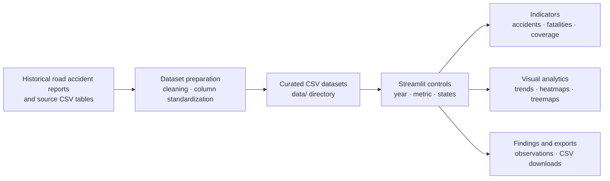

<div align="center">

<a href="https://roadsafe-intelligence.streamlit.app/">
  
</a>

<br>

<a href="https://roadsafe-intelligence.streamlit.app/">
  
</a>
<a href="https://github.com/karthikhs25/ROADSAFE">
  
</a>

<br><br>

<a href="https://www.python.org/"></a>
<a href="https://streamlit.io/"></a>
<a href="https://plotly.com/python/"></a>


<br><br>


<br>

**A data-driven road safety intelligence and visualization dashboard for India.**

[Live dashboard](https://roadsafe-intelligence.streamlit.app/) · [Source code](https://github.com/karthikhs25/ROADSAFE) · [Overview](#01--overview) · [Dashboard intelligence](#02--dashboard-intelligence) · [Data logic](#05--data-logic) · [Run locally](#08--run-locally) · [Limitations](#10--limitations)

</div>

---

<div align="center">

### UNDERSTANDING ROAD SAFETY THROUGH DATA

</div>

## `01` / Overview

**ROADSAFE — Smart Road Accident Data Intelligence and Visualization System** is an interactive Streamlit dashboard that transforms historical Indian road accident statistics into accessible visual analysis.

Instead of reading disconnected tables, users can examine time trends, compare state-level outcomes, investigate road and collision categories, and explore reported road-user and safety-device statistics in one interface.

<table>
<tr>
<td width="33%" align="center"><h2>09</h2><strong>Curated datasets</strong><br><sub>Different analytical perspectives</sub></td>
<td width="33%" align="center"><h2>12</h2><strong>Dashboard sections</strong><br><sub>Visual analytics and data explorer</sub></td>
<td width="33%" align="center"><h2>2012–2023</h2><strong>Combined year coverage</strong><br><sub>Varies by dataset</sub></td>
</tr>
</table>

> [!IMPORTANT]
> **HISTORICAL DATA — NOT LIVE INCIDENT MONITORING.** ROADSAFE uses published road accident statistics and supplied historical CSV tables. Dataset years, units, and geographical coverage differ. Counts do not by themselves measure individual risk or establish accident causes.

## `02` / Dashboard intelligence

Different visualizations help answer different road safety questions.

<table>
<tr>
<td width="50%" valign="top">

### ACCIDENT TRAJECTORY

Annual national accident and fatality trends, derived from the available monthly records.

</td>
<td width="50%" valign="top">

### MONTHLY PATTERNS

Monthly trend lines and year-by-month heatmaps reveal seasonal variation in reported counts.

</td>
</tr>
<tr>
<td width="50%" valign="top">

### ROAD CATEGORY MIX

Compare accidents, fatalities and injuries across National Highways, State Highways and Other Roads where available.

</td>
<td width="50%" valign="top">

### STATE INTELLIGENCE

Explore state/UT fatality trends and compare reported state accident counts for their respective available years.

</td>
</tr>
<tr>
<td width="50%" valign="top">

### REGIONAL TREEMAP

A visual breakdown of state-level accident counts for supported historical years.

</td>
<td width="50%" valign="top">

### ROAD-USER OUTCOMES

Compare fatalities by victim road-user category, without confusing victim categories with crash-causing vehicles.

</td>
</tr>
<tr>
<td width="50%" valign="top">

### COLLISION INTELLIGENCE

Compare reported collision types using bar charts and treemap views.

</td>
<td width="50%" valign="top">

### SAFETY-DEVICE OUTCOMES

Review reported fatality and injury figures associated with helmet and seat-belt non-use.

</td>
</tr>
<tr>
<td width="50%" valign="top">

### JUNCTION ANALYSIS

Explore 2019 accident distributions by junction type and reporting location.

</td>
<td width="50%" valign="top">

### AUTOMATED FINDINGS & EXPORT

See selected-year highlights, inspect source tables, and download CSV datasets.

</td>
</tr>
</table>

## `03` / Key indicators

<div align="center">

<table>
<tr>
<td align="center" width="25%"><sub>01 / ACCIDENTS</sub><h2>Count</h2><strong>Reported accidents</strong><br><sub>Sum of available monthly values</sub></td>
<td align="center" width="25%"><sub>02 / FATALITIES</sub><h2>Count</h2><strong>Reported deaths</strong><br><sub>Sum of available monthly values</sub></td>
<td align="center" width="25%"><sub>03 / COVERAGE</sub><h2>States</h2><strong>State / UT records</strong><br><sub>Available for selected year</sub></td>
<td align="center" width="25%"><sub>04 / INFRASTRUCTURE</sub><h2>Roads</h2><strong>Road categories</strong><br><sub>Available for selected year</sub></td>
</tr>
</table>

</div>

> [!NOTE]
> Dashboard KPI values change with the reporting year. An unavailable dataset is shown as unavailable rather than replaced with an invented figure. State filters apply to state-level views, not national totals.

## `04` / How the data moves

ROADSAFE loads curated CSV tables, validates their structure, applies the relevant year and state filters, and generates interactive visualizations and descriptive findings.



## `05` / Data logic

### Data coverage

| Dataset | Years | Purpose |
|:--|:--|:--|
| `road_accidents.csv` | 2016–2019 | State/UT accident counts |
| `state_fatalities.csv` | 2019–2023 | State/UT fatality counts |
| `monthly_accidents.csv` | 2019–2023 | Monthly national accident and fatality trends |
| `road_types.csv` | 2021–2023 | Road-category comparisons |
| `road_user_fatalities.csv` | 2022–2023 | Fatalities by victim road-user category |
| `collision_types.csv` | 2022–2023 | Collision-type outcomes |
| `safety_device_totals.csv` | 2023 | Helmet and seat-belt non-use outcomes |
| `junction_types_2019.csv` | 2019 | Junction-category outcomes |
| `historical_vehicle_context.csv` | 2012–2023 | Historical national vehicle/accident context |

### Processing principles

- Read local CSV files using **Pandas**.
- Standardize column names and convert relevant numeric fields.
- Keep each dataset's original reporting years and units explicit.
- Use national tables for national charts and state tables for state comparisons.
- Show an availability message when a selected year has no compatible records.
- Avoid treating absolute counts as population-adjusted or vehicle-adjusted risk rates.

### Source discrepancy

The monthly accident figures for **2021** sum to **412,632**, while the source report lists an annual total of **412,432**. ROADSAFE retains the supplied monthly values rather than silently changing them.

## `06` / Technology

<div align="center">

| APPLICATION | DATA PROCESSING | VISUALIZATION |
|:---:|:---:|:---:|
| Python · Streamlit | Pandas · CSV | Plotly |

</div>

| Technology | Responsibility |
|:--|:--|
| **Python** | Application logic and analysis |
| **Streamlit** | Interactive interface, filters and downloads |
| **Pandas** | Data loading, aggregation and transformations |
| **Plotly** | Interactive trends, bars, donuts, heatmaps and treemaps |
| **CSV** | Portable historical data files |
| **GitHub** | Source control and project documentation |
| **Streamlit Community Cloud** | Web application hosting |

## `07` / Live deployment

ROADSAFE is hosted on **Streamlit Community Cloud**.

<div align="center">

### [LAUNCH THE ROADSAFE LIVE DASHBOARD](https://roadsafe-intelligence.streamlit.app/)

<a href="https://roadsafe-intelligence.streamlit.app/"></a>

</div>

The deployed app reads the files committed to this repository. Changes to local CSV files will not appear on the hosted dashboard until the updated files are pushed to GitHub and the deployment refreshes.

## `08` / Run locally

### Requirements

- Python 3.10 or later
- pip
- Project source code and the `data/` directory

### Project structure

```text
ROADSAFE/
│
├── app.py
├── README.md
├── requirements.txt
│
└── data/
    ├── road_accidents.csv
    ├── state_fatalities.csv
    ├── monthly_accidents.csv
    ├── road_types.csv
    ├── road_user_fatalities.csv
    ├── collision_types.csv
    ├── safety_device_totals.csv
    ├── junction_types_2019.csv
    └── historical_vehicle_context.csv
```

### Launch

```bash
# Clone the repository
git clone https://github.com/karthikhs25/ROADSAFE.git
cd ROADSAFE

# Install dependencies
python -m pip install -r requirements.txt

# Run the dashboard
python -m streamlit run app.py
```

Open the address printed by Streamlit, usually `http://localhost:8501`.

## `09` / Interpreting the findings

ROADSAFE highlights patterns such as the highest recorded accident month, the road category with the largest reported accident count, and the state/UT with the highest reported fatalities for the selected year, where the relevant data exists.

A larger accident count does **not** automatically mean a location or road category is inherently more dangerous. Differences in population, traffic volume, road length, reporting practices and exposure can affect totals. The visualizations support exploration, not causal claims.

## `10` / Limitations

- The dashboard uses historical published statistics; it is **not** a live crash detection or emergency response system.
- Different datasets cover different years, geographical levels and reporting units.
- State-level accident counts and fatality counts do not have identical year coverage.
- Road-user categories describe victims, not necessarily vehicles responsible for collisions.
- Some national historical vehicle figures are rounded to thousands.
- The 2021 monthly-versus-annual accident total discrepancy is retained and disclosed.
- The dashboard does not calculate standardized risk rates unless an appropriate denominator is available.
- Observed correlations and category differences do not establish causes.

## `11` / Future scope

- Verified geographic maps for Indian states and UTs.
- Additional harmonized state-level accident, injury and fatality series.
- Population- or traffic-normalized risk indicators where denominators are reliable.
- Better dataset quality checks and metadata documentation.
- More detailed comparisons by weather, road conditions and time of day, subject to source availability.

## `12` / Data attribution

**Primary reference:** Ministry of Road Transport and Highways (MoRTH), Government of India — *Road Accidents in India 2023*, alongside the supplied historical CSV tables.

The repository is an academic data-visualization project. Source statistics remain attributable to their respective publishers; the dashboard is not an official government service.

---

<div align="center">


### UNDERSTAND THE DATA. IDENTIFY THE PATTERNS. SUPPORT SAFER ROADS.

**ROADSAFE INTELLIGENCE**

<sub>Academic project · Interactive analytics · Historical Indian road accident data</sub>

<br><br>

<a href="https://roadsafe-intelligence.streamlit.app/"></a>

</div>
